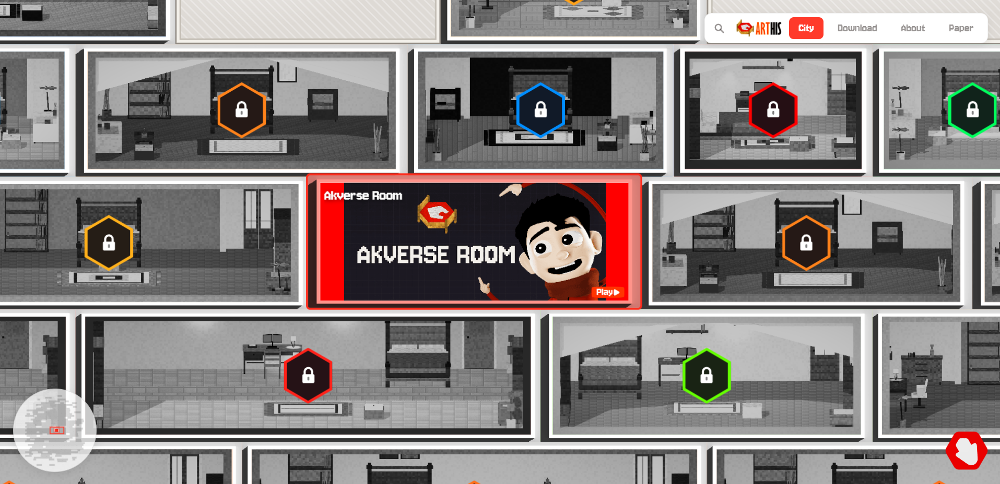
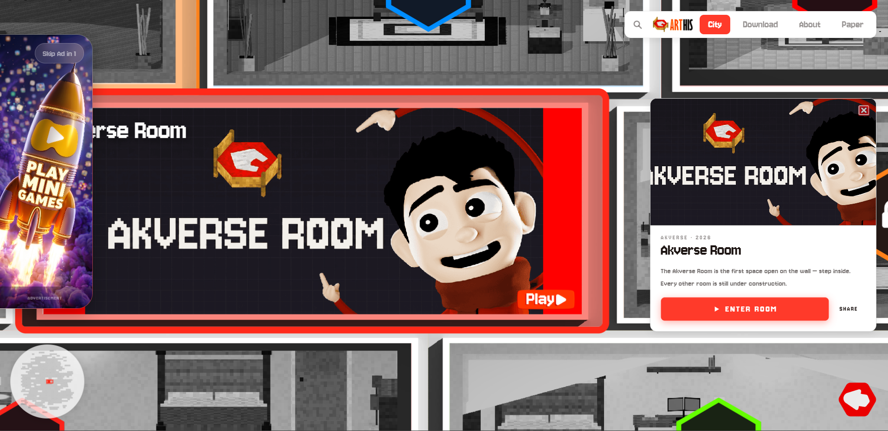
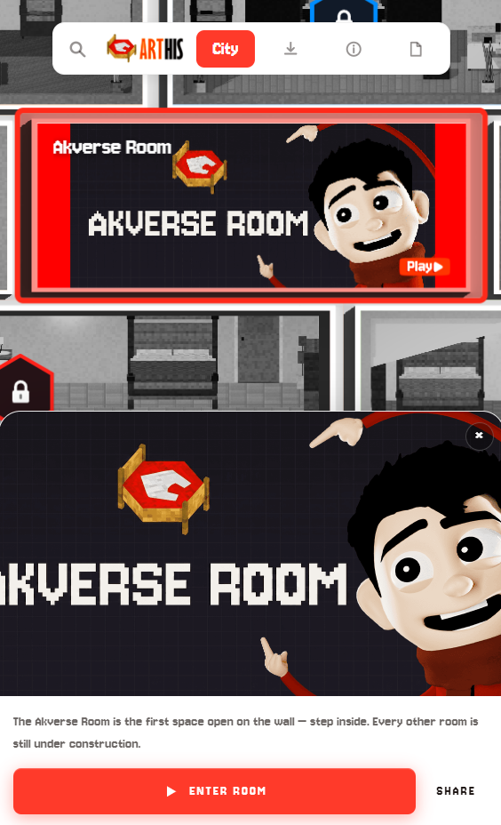

<div align="center">


# 🌆 ARTHIS.land — The Wall

### A handcrafted, vertical city you explore in the browser. Real-time multiplayer, pulled from the Arthis archive.

[![Enter The Wall](https://img.shields.io/badge/Enter-arthis.land-8C242F?style=for-the-badge&labelColor=1A1A1A&logo=data:image/png;base64,iVBORw0KGgoAAAANSUhEUgAAACAAAAAgCAYAAABzenr0AAAJUklEQVR42r2Xe4xdR33HPzNzXve1d+++vGuvvV7bScEbgsF5NKGJvXlUVElUIPJCK1EBAYKEEBFCoADt9aoCUQlSkIASlypFIQ2x0zQhaYJSguOUtHIUNyVpNlES2+v4uXt37/vcc+45Z2b6h6mEowRIBXyl0Wh++s3M5/eTRvoOvI727kLZKvJrN49de/etGw7vuWXykwC2iuS3rNc/cOtWJeYxU8PFD+aV2BRF+k8A9i0gftsAzmsDdv8OR8weSA599x03rB8t3vjUf5+0YZT2+R3pHAC7d5cSs/uylSc+cKnsh/fUT5zykyQTcWLk7wpAnnP53D796o9v2JJ3zY/qZ1ZzSZRmum/QfS0syE1HkJbffOwF9Rt1wFarUszN66dv3z5SUOahzvLKWKPW1DmFamYpS0pmAgyHMG+2QgtS8Mb7xP7qDuc7Cwfsl/9oi5PkSo9VBvPvilKypBs5y62WPfVwTax9Jqyt0/rZZoBIDXbSgg/UgTFAAL49O0cCQjCDAtmDh8brfMOCIyB7XQAAKSUnf3TNfbrTfm870pknlFPrtFh9rMbaB1YYzUE/AF+ABxgBjhAoIaggAEGKJRaA1ih7NkcI6Bg+MlHnjjeCcP7mwyPXv/PtkzfpOHrP8VcbenzdqNMMW0TPNNn04CpOIIh97KAVxpMCiSC2mpa2uH3LqRQKGnISYgVuCYpIusbYRCKE5HuvjHBGrPDIfnBmXwMh9twyaXVmGPeFXjeSV7mxIs3nGxS+8yolY8jlJaXM4CQQJWdbphzoj5WJNm1GbDqf3tgE2cQE/tHDBHtup+iAKiiWtTYIhA/hK4KdV61wyIISoKtV5MwCwgk8xWqkNZ5QwpckDU3xH05Qzgy2IMi1DbKcJ948TbR1K+LCtyPfOoNeP4UZHiZzXbTOsNqQBTnSK64i/OLnCI4cY3RIyTrGSGuLGy0PvrCGy8USi3tBzc2jARxtrLXaKqMEUjjYb75CoZ3hlwTF1KXxjdvILrmYYP0kolgi1RlkKWm3iw47YCw5z0VJhQxTsp07Se5/mP7uv6T0z/dRHkC2PakLxkxIw0P/s5UrL1igfuenNmztWlOUcV+LXl/TSwzO7ccYON7DLQkCKen1EuRwGfdtM+g4pn/mNOnp09BqQz/BD3L4+TxGSLQxpFJhmg2s52K//Xc0v/51+uQptoyKhMgKlpnBM9x713XlylI/fdB3OSilhdiViEeb5F/sYkrgYFEC2gL0Pf9EHkm+UCA/MEC+XEZ6HspxUEphjAGtoTyITVNMqqFcRtRXkR/4M6KfPEF60SU4EU5TSO1lzF740/a9q1FWyTJrpVZQbGqGXugRDgi0PPvUQmNQRZAHf0Zj4XnacUzU7dJq1Ol1O0il6Pdj0jjGHRnFPPIQ9j03YN53PdndP8QGBRCS3oljhL0QLUEgVL2NGf/4zFUbR3KVbqSROjGIiqJy9QhJZEk8QShBC4sKFM5SB+8/nkQUi5gspVgqUakMkcvncaWiJyXdBx8g+NhNuCdfIlg6invLp7F/sQvv85/Fff+NtF56HpkT2Jom+OD5MnnvpDFhigGkVJKclBQ+NI1/2TC9lqXlCVwgZyB0wTz2MKV8gYHSAEo59HohzfrZTviFItG//SvdDIjBxCBHBOrpp8ju+gFxCRiQLK0Ystkx1EffQkUVpZfzwRrUJVv83Y4QTI/mEJeNMXQkwl+M0EVBagzKF3iHj9ObvZZk7QQ6DEn6fTAapRSBgNz2S8lmd8KGKWQuIFo6Q1lZooKihGVy2dK9uIL/hXdSsB5CGJ5fOEWUGtS73uLvLg8WWT8SmLSfMPjH06Lz8xVYTnACQSIFXjcjt7hIf+ZCFAKdK+BUKlAoYl0POTSEe955iGuuJdl+MeLO7+NnfaSw1LoWMVXA+9I2pLW0lhvEYWif/nlN1Fp9nInRACkM6zatlaePniIWGv8L22h/7iAjnZR83mJLkPvZfpx3X0F9cJDS8Dje5Hq6G6aIpqaQk1PI4WHSTZtx/34P7nKH0oCCnqE94rN0yxbGPImDxPFdGzaaAp0xPBTgBL6TnTzTtQsvL983ORS8P23HpriuIoK/vkzEtx7Ei/vYnKA/IDDW4IUNgkaD/IsvoDLIC5AOeL4iHB4mjtqUCoJ6weXu6yu8dUOe88suupeiSnkrTSY63TTsgxzNO4Gcnhpwtl8w5D6yf+E2V8lPj40EUjejLJtw8XdfypKROG1Lv21QLdAR9DQkAC44LligEWns0WVYiWmHlsPjHs0xiVaWLMroJ4lJuiGnT6x2IqvmgrxbHx3JCWe1Hj0Q981IuVI+uvHP//Op57430dZyXt28criRjr1tyvVumubV/WfwB1zKjqKHJa8k2nVIjEFjyVJNrhBQ9HyEztBhSttPyYcaWZIghcVoqxNkrRbP3fi3rzx6160b1+Vyzrkud391hzM7fyD78V9N379+ovinfqmUdZLEOXK8xnClQJD3yNIMz/coFAOUUggB3W6PXCGP53sEeZ+w2eHfnzjMclOzeTxnz1tb0KNrBpzF462br/jswp47qlNBZzn9yGDRqQlbRYp5DCCsBXZXxW0L8/7ll8/8tBTIP9SoLAn7TpJqdGbwfAepJFIKBoYGUK4ijRO6rZCwEzG6bgSbJDzzwjKLrYxNY0F2xbZxZ7WT7d72if+af/rj292L9hxKz3FE53i4XwA9fOuWUeWmTw4N5s4Trp/U6x3Z6/YZW1NCSoHRltJgHiklYTfCGovRhiTV2DRjcSmWJzqpveayKTW9YXjPmusevfkXlj8DqFZxZhaw4o1+RnP70Pd9Zu35GzYOP7nt4s0j3XYPnWYsn6ghpMDzXYyxJEnGsSM1KkMFSqWAkyca6CTlpdMpDSsZHy48/slvH5+9+0ardu3FCIH9lR8TgLl96L17d6n3ze176dl/XH917eTqlY0wMVJYERuJTg0mimisRvT7KSY1LNd7LNdjojhTxcDRmWOvdDI91+xEh7Sx/KSCnBNnTcivBQCYm9unq1XkhR86+Czw7Ju141/98Jp4el0w1+oZz4LYPXFu5b8WAGB+HmOrSHbukI//X/Dx12YdOGe1yJSzkWPZczWnYCy2WPSMAFvl96T91R0OwL3VzZ956rsz9oGv/MG3fjn+pjrw/1Ft4YAFaHeTl8/UWOz17L/8cvy1+l8oJIMqVJ3w1gAAAABJRU5ErkJggg==)](https://arthis.land)
&nbsp;

-990000?style=for-the-badge&logo=webgl&logoColor=white)

</div>

<p align="center">

</p>

> _This repository is a project showcase. The source code for the ARTHIS.land client is private — this page explains what it is and how it works. Its multiplayer backend is open: **[arthisland-relay](https://github.com/akversebusiness-beep/arthisland-relay)**._

---

## What is ARTHIS.land?

**ARTHIS.land — "The Wall"** is a handcrafted **vertical city**: an interactive experience you climb and explore, built from pieces of the Arthis archive. It's designed as a place to wander rather than a game to win — atmospheric, dense, and a little strange.

It runs in your browser via **Unity + WebGL**, and it's **multiplayer** — you can share a space with others in real time.

## Highlights

- 🏙️ **A vertical city** — a tall, handcrafted world you move up through
- 🎮 **Built in Unity** — shipped to the browser with WebGL (and standalone builds)
- 👥 **Real-time multiplayer** — 2–4 players share a room and see each other move
- 🔑 **Room codes** — host a space and invite others with a simple 4-digit code
- 🗄️ **From the archive** — scenes and assets curated from the Arthis collection

## How it works

ARTHIS.land is a Unity client that connects to a lightweight relay for multiplayer. The client owns the world and the players; the relay simply moves messages between everyone in a room.

```text
┌──────────────┐ ┌──────────────┐ ┌──────────────┐
│ Player 1 │ │ Player 2 │ │ Player 3/4 │
│ Unity (WebGL)│ │ Unity (build)│ │ Unity │
└──────┬───────┘ └──────┬───────┘ └──────┬───────┘
│ HOST:1234 / JOIN:1234 · STATE · SCENE · NAME │
└───────────────┬───────────────┬───────────────┘
▼ ▼
┌───────────────────────────┐
│ arthisland-relay │
│ rooms · 2–4 players · TCP │
│ + WebSocket · stdlib only │
└───────────────────────────┘
```

1. **Join a space.** One player hosts a room (`HOST:<code>`); others join it (`JOIN:<code>`). Each player is assigned a stable ID.
2. **Sync in real time.** Every client streams its state, scene, and name to the relay, which fans those updates out to everyone else in the room (`P:<id>,STATE:…`).
3. **Leave cleanly.** When someone disconnects, the others are notified (`LEFT:<id>`) and the world updates. When the last player leaves, the room closes.

The relay is transport-agnostic — **WebGL** builds connect over **WebSocket**, standalone builds over **plain TCP**, both on the same port. See **[arthisland-relay](https://github.com/akversebusiness-beep/arthisland-relay)** for the full protocol.

## Tech


## Screenshots

<p align="center">

<br/><em>The Akverse Room — the first space open on the wall</em>
</p>

<p align="center">

<br/><em>The Wall, on mobile</em>
</p>

## The ARTHIS universe

| Project | What it is |
| ------- | ---------- |
| 🌆 **[ARTHIS.land](https://arthis.land)** | This — "The Wall," the vertical city |
| 🎮 **[ARTHIS.space](https://arthis.space)** | An endless feed of single- & multiplayer mini-games |
| 🛰️ **[arthisland-relay](https://github.com/akversebusiness-beep/arthisland-relay)** | The real-time multiplayer relay backend |

---

<div align="center">
Made by <a href="https://github.com/akversebusiness-beep">@akversebusiness-beep</a> · <a href="https://arthis.land">arthis.land</a>
</div>
